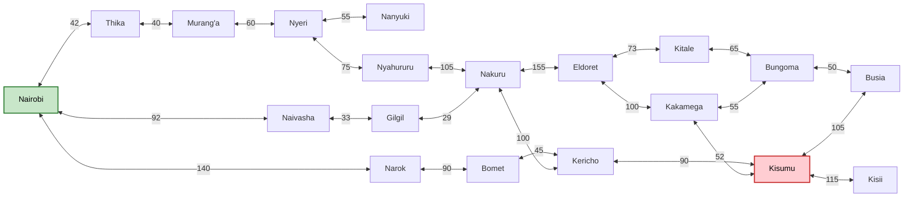
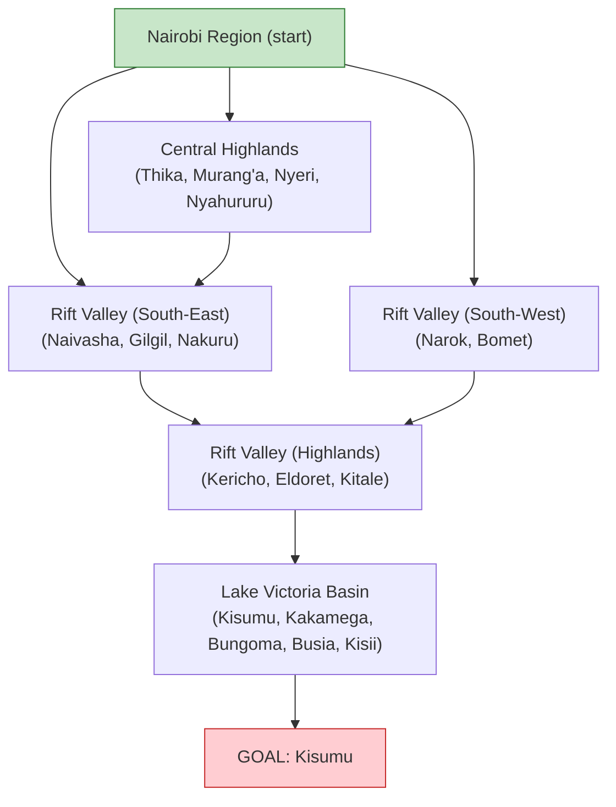
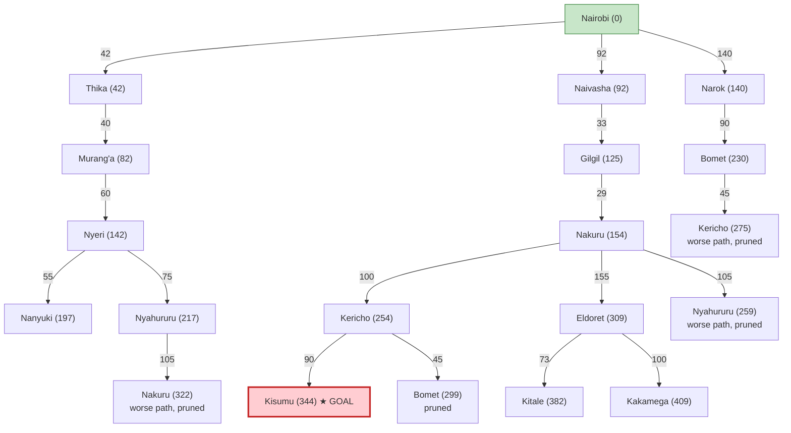

#  Practical Exercise 3: Designing a Searching Agent

**Members:** Phillip Mwengi-165056
            Emmanuel Kiprotich-189802
            Wilson Mutua-184179

---

## 1. PEAS Description of the Self-Driving Trailer Agent

The agent is an autonomous freight trailer (truck-trailer) that moves cargo between towns on Kenya's highway network.

| Component | Description |
|---|---|
| **P – Performance measure** | Total distance travelled (path cost, to be minimised); safe arrival with no collisions; cargo delivered intact and on time; fuel efficiency; compliance with traffic laws and axle-load/speed limits; passenger and pedestrian safety. |
| **E – Environment** | Kenya's highway network (e.g. A104 Nairobi–Nakuru–Eldoret, A1 Nakuru–Kericho–Kisumu) across Nairobi, the Central Highlands, the Rift Valley and the Lake Victoria Basin; other vehicles (matatus, buses, trucks, motorbikes), pedestrians, livestock, road works, police checks, weather (rain, fog on escarpments), road surface and gradient, towns and junctions. |
| **A – Actuators** | Steering, accelerator, brake (service and engine brake), gear selector, indicators, headlights, horn, hazard lights, trailer coupling/air-brake controls, communication unit (to report position and status to dispatch). |
| **S – Sensors** | GPS and digital road map, LiDAR, radar, front/rear/side cameras, ultrasonic sensors, speedometer and odometer, fuel gauge, tyre-pressure sensors, accelerometer/gyroscope (IMU), load/weight sensors, rain and light sensors, mobile network/telemetry link. |

---

## 2. Task Environment Properties

| Property | Classification | Justification |
|---|---|---|
| **Fully vs. partially observable** | **Partially observable** | Sensors have limited range. The agent cannot see round blind bends, hidden vehicles, potholes under water, or traffic jams ahead, and does not know other drivers' intentions. |
| **Single vs. multi-agent** | **Multi-agent** (competitive and cooperative) | Many other drivers, pedestrians and animals share the road. Cooperative: avoiding collisions, giving way. Competitive: overtaking, competing for road space. |
| **Deterministic vs. stochastic** | **Stochastic** | The next state is not fully determined by the action: traffic, weather, breakdowns, accidents and road works are uncertain. |
| **Episodic vs. sequential** | **Sequential** | Current decisions (route choice, speed, fuel use) affect later states. Choosing a road at Nairobi fixes which towns can be reached next. |
| **Static vs. dynamic** | **Dynamic** | The environment keeps changing while the agent deliberates (moving traffic, changing weather and road conditions). |
| **Discrete vs. continuous** | **Continuous** at driving level (speed, steering angle, position) but **discrete** at the route-planning level (a finite set of towns and roads). | We abstract the map to a discrete graph for searching. |
| **Known vs. unknown** | **Known** (map/rules) but with unknown live conditions | The road network and driving rules are known, so search is possible. |

**Summary:** partially observable, multi-agent, stochastic, sequential, dynamic, continuous (abstracted to discrete for planning).

---

## 3. Problem Formulation (Route Planning)

| Element | Definition |
|---|---|
| **States** | The town where the trailer is currently located (e.g. `Nairobi`, `Nakuru`, `Kisumu`). |
| **Initial state** | `Nairobi` |
| **Actions** | Drive along a highway to an adjacent town, e.g. `Go(Naivasha)`. |
| **Transition model** | `Result(In(Nairobi), Go(Naivasha)) = In(Naivasha)` |
| **Goal test** | `In(Kisumu)` |
| **Path cost** | Sum of road distances (km) between towns. |

---

## 4. Directed Graph of the Highway Network

Road distances are approximate driving distances (km) obtained from Google Maps. Each road can be driven in both directions, so every road is drawn as two directed arcs (a double-headed arrow).

### 4.1 Edge table

| From ↔ To | Region | Distance (km) |
|---|---|---|
| Nairobi ↔ Thika | Nairobi → Central | 42 |
| Thika ↔ Murang'a | Central | 40 |
| Murang'a ↔ Nyeri | Central | 60 |
| Nyeri ↔ Nanyuki | Central | 55 |
| Nyeri ↔ Nyahururu | Central | 75 |
| Nyahururu ↔ Nakuru | Central → Rift Valley | 105 |
| Nairobi ↔ Naivasha | Nairobi → Rift Valley | 92 |
| Naivasha ↔ Gilgil | Rift Valley | 33 |
| Gilgil ↔ Nakuru | Rift Valley | 29 |
| Nairobi ↔ Narok | Nairobi → Rift Valley | 140 |
| Narok ↔ Bomet | Rift Valley | 90 |
| Bomet ↔ Kericho | Rift Valley | 45 |
| Nakuru ↔ Kericho | Rift Valley | 100 |
| Nakuru ↔ Eldoret | Rift Valley | 155 |
| Eldoret ↔ Kitale | Rift Valley | 73 |
| Eldoret ↔ Kakamega | Rift Valley → Lake Victoria | 100 |
| Kitale ↔ Bungoma | Rift Valley → Lake Victoria | 65 |
| Kericho ↔ Kisumu | Rift Valley → Lake Victoria | 90 |
| Kakamega ↔ Kisumu | Lake Victoria | 52 |
| Kakamega ↔ Bungoma | Lake Victoria | 55 |
| Bungoma ↔ Busia | Lake Victoria | 50 |
| Kisumu ↔ Busia | Lake Victoria | 105 |
| Kisumu ↔ Kisii | Lake Victoria | 115 |

### 4.2 Graph diagram

Green = start (Nairobi), red = goal (Kisumu).

---

## 5. Search Tree with Abstraction

### 5.1 Abstraction

Searching every road and village at once is wasteful, so we use **hierarchical abstraction**: remove detail until the problem is easy, then add it back.

- **Level 1 (most abstract): regions.** Nairobi → Central Highlands / Rift Valley → Lake Victoria Basin. This answers "which regions do we cross?".
- **Level 2 (detailed): towns.** Within each region we pick the actual towns and roads.

#### Level 1: abstract search tree (regions)

The abstract plan is: **Nairobi → Rift Valley → (Rift Valley highlands) → Lake Victoria Basin (Kisumu)**. Going via the Central Highlands is possible but only reaches the Rift Valley by a long detour.

#### Level 2: refinement of each abstract step into towns

| Abstract step | Refined into towns |
|---|---|
| Nairobi → Rift Valley (South-East) | Nairobi → Naivasha → Gilgil → Nakuru |
| Rift Valley (South-East) → Highlands | Nakuru → Kericho |
| Highlands → Lake Victoria Basin | Kericho → Kisumu |

### 5.2 Detailed search tree (Level 2)

The tree starts at Nairobi and expands towns in order of path cost g(n) in km (a node shown more than once is a repeated state reached by a different path). Cumulative cost is shown in brackets.

The optimal branch is **Nairobi → Naivasha → Gilgil → Nakuru → Kericho → Kisumu**.

---

## 6. Optimal Path from Nairobi to Kisumu (Path Cost = Distance)

### 6.1 Algorithm: Uniform-Cost Search (UCS)

Because every road has a different cost, we use **Uniform-Cost Search**, which always expands the frontier node with the lowest path cost g(n). With non-negative costs, UCS is **complete and optimal**.

### 6.2 Trace

| Step | Node expanded (cost) | Frontier after expansion (node: cost) |
|---|---|---|
| 1 | Nairobi (0) | Thika: 42, Naivasha: 92, Narok: 140 |
| 2 | Thika (42) | Naivasha: 92, Narok: 140, Murang'a: 82 |
| 3 | Murang'a (82) | Naivasha: 92, Narok: 140, Nyeri: 142 |
| 4 | Naivasha (92) | Narok: 140, Nyeri: 142, Gilgil: 125 |
| 5 | Gilgil (125) | Narok: 140, Nyeri: 142, Nakuru: 154 |
| 6 | Narok (140) | Nyeri: 142, Nakuru: 154, Bomet: 230 |
| 7 | Nyeri (142) | Nakuru: 154, Nanyuki: 197, Nyahururu: 217, Bomet: 230 |
| 8 | Nakuru (154) | Nanyuki: 197, Nyahururu: 217, Bomet: 230, Kericho: 254, Eldoret: 309 |
| 9 | Nanyuki (197) | Nyahururu: 217, Bomet: 230, Kericho: 254, Eldoret: 309 |
| 10 | Nyahururu (217) | Bomet: 230, Kericho: 254, Eldoret: 309 |
| 11 | Bomet (230) | Kericho: 254 (via Bomet = 275, worse, ignored), Eldoret: 309 |
| 12 | Kericho (254) | Eldoret: 309, Kisumu: 344 |
| 13 | Eldoret (309) | Kisumu: 344, Kitale: 382, Kakamega: 409 |
| 14 | **Kisumu (344)**: goal test passed | Search stops |

### 6.3 Result

**Optimal path:** Nairobi → Naivasha → Gilgil → Nakuru → Kericho → Kisumu

| Leg | Distance (km) |
|---|---|
| Nairobi → Naivasha | 92 |
| Naivasha → Gilgil | 33 |
| Gilgil → Nakuru | 29 |
| Nakuru → Kericho | 100 |
| Kericho → Kisumu | 90 |
| **Total** | **344 km** |

### 6.4 Comparison with alternative routes

| Route | Total distance (km) |
|---|---|
| **Nairobi → Naivasha → Gilgil → Nakuru → Kericho → Kisumu** | **344** ✅ |
| Nairobi → Narok → Bomet → Kericho → Kisumu | 365 |
| Nairobi → Naivasha → Gilgil → Nakuru → Eldoret → Kakamega → Kisumu | 461 |
| Nairobi → Thika → Murang'a → Nyeri → Nyahururu → Nakuru → Kericho → Kisumu | 512 |

The Nakuru–Kericho–Kisumu route is the shortest, which matches the route used by trucks on this corridor.

---

## 7. References

- Russell, S. & Norvig, P., *Artificial Intelligence: A Modern Approach* (PEAS, task environments, uninformed search).
- Google Maps, road distances between Kenyan towns.
- ICS 3202 class notes on the self-driving trailer agent and abstraction.
